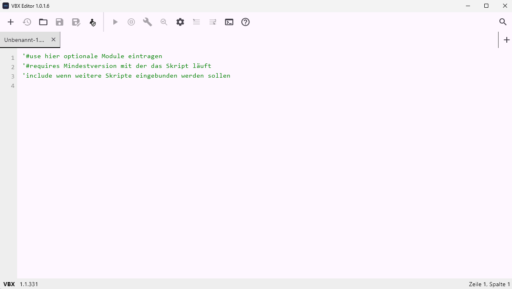

# VBX Editor

Der **VBX Editor** ist ein Editor für [VBX](../vbx)-Skripte (`.vb`) unter Windows und Linux.



## Features

### Editor

* **Mehrere Tabs** – gleichzeitiges Bearbeiten mehrerer Dateien, mit Änderungsmarkierung (`*`) und Speicherabfrage (Ja/Nein/Abbrechen) beim Schließen
* **Zeilennummern** – synchron mitscrollende Gutter-Anzeige links im Editor
* **Zeile/Spalte live** – Anzeige in der Statusleiste, aktualisiert sich mit der Cursorposition
* **Syntax-Highlighting** – farbliche Darstellung der VBX-Syntax, passend zum gewählten Theme
* **Live-Syntax-Hinweise** – zeigt beim Tippen automatisch Signatur und Beschreibung der aktuellen Modul-/globalen Funktion an
* **Autovervollständigung** – bei `modul.` erscheint ein Popup mit passenden Funktionen (Pfeiltasten/Enter/Tab/Escape oder Mausklick)
* **Auto-Einrückung** – berücksichtigt verschachtelte `If`/`For`/`While`/`Do`/`Sub`/`Function`/`Select Case`; fügt beim Anlegen eines neuen Blocks automatisch den passenden Abschluss ein; formatiert `.vb`-Dateien zusätzlich beim Speichern komplett neu ein
* **Kommentar umschalten** – markierte Zeilen per Klick aus-/einkommentieren
* **Suche im Editor** – Vorwärts-/Rückwärtssuche mit Hervorhebung aller Treffer (aktueller Treffer stärker markiert)
* **Drag & Drop** – Dateien direkt in den Editor-Bereich ziehen zum Öffnen
* **Standard-Vorlage** – neue Tabs starten mit Kommentar-Hinweisen zu `#use`/`#requires`/`include`

### Ausführen & Build

* **Direktes Ausführen (F5)** – führt die aktuelle Datei über die konfigurierte VBXC-Runtime aus
* **Dry Run** – simuliert die Ausführung des Skripts, um zu sehen, ob Fehler im Skript vorhanden sind, ohne es normal auszuführen
* **Ausführung stoppen** – laufende VBX-Ausführung kann jederzeit abgebrochen werden
* **Build** – startet den Build direkt über das Toolbar-Dropdown für Windows oder Linux (`vbxc build <ziel> <datei.vb>`)
* **Automatische `#use`-Ergänzung** – fehlende, tatsächlich verwendete optionale Module werden vor dem Ausführen automatisch in die `#use`-Zeile eingetragen (mehrfache/fehlplatzierte `#use`-Zeilen werden bereinigt)
* **Konsole** – eingebettete System-Shell (`cmd.exe` unter Windows, Bash unter Linux), umschaltbar gegen die normale Programm-Ausgabe im unteren Panel

### Administrator-Modus

* Der Editor kann über die Windows-UAC als **Administrator** neu gestartet werden.
* Dabei wird die aktuell geöffnete Datei übernommen.
* Der Administrator-Modus wird im Fenstertitel angezeigt, z. B. `Administrator: VBX Editor 2.0.0`.
* Ist der Editor bereits als Administrator gestartet, ist der Administrator-Button deaktiviert.

### Hilfe & Dokumentation

* **Hilfe-Panel** – seitliches, ein-/ausblendbares Panel mit Modul-Dokumentation aus `.md`-Dateien, Text markier- und kopierbar
* Dokumentation wird bei Bedarf von GitHub geladen und lokal gecacht (kein Internet nötig für bereits geladene Inhalte)

### Dateiverwaltung

* **Öffnen unterstützt** neben `.vb` auch `.txt`, `.json`, `.ini`, `.csv`, `.xml`, `.yaml`/`.yml`, `.log`, `.cfg`, `.env` (nur `.vb` ist ausführbar/buildbar)
* **Speichern unter** – unabhängig vom bestehenden Dateipfad an neuem Ort speichern
* **Neu laden** – aktuellen Tab-Inhalt von der Festplatte neu einlesen (mit Sicherheitsabfrage bei ungespeicherten Änderungen)
* **Letzte Sitzung wiederherstellen** – offene Tabs (inkl. ungespeicherter Änderungen) werden beim Beenden gesichert und beim nächsten Start wiederhergestellt
* **Single Instance** – ein zweiter Start (z. B. per Doppelklick oder „Öffnen mit“) reicht die Datei an die bereits laufende Instanz weiter, statt ein zweites Fenster zu öffnen
* **Explorer-Integration** (optional, über Einstellungen) – registriert „Öffnen mit VBX Editor“ im Kontextmenü für unterstützte Dateitypen

### Sonstiges

* **Dark/Light-Theme** – umschaltbar über Einstellungen-Dialog
* **Schriftgröße** einstellbar
* **Fenstertitel** zeigt die Editor-Versionsnummer

### Voraussetzungen

* Windows oder Linux
* VBXC Runtime für das jeweilige Betriebssystem

### Linux-Build

Der Linux-Release-Build wird auf einem Linux-System mit eingerichteter Flutter-Linux-Desktop-Umgebung erstellt:

```sh
flutter build linux --release
```

Das lauffähige Bundle liegt anschließend unter `build/linux/x64/release/bundle/`. VBXC muss als Linux-Version installiert und über `PATH` erreichbar sein (`vbxc`) oder in den Einstellungen mit seinem vollständigen Pfad eingetragen werden.

Unter Linux speichert der Editor seine Konfiguration und Sitzung in `${XDG_CONFIG_HOME:-$HOME/.config}/vbx-editor` und den Dokumentationscache in `${XDG_CACHE_HOME:-$HOME/.cache}/vbx-editor`.
